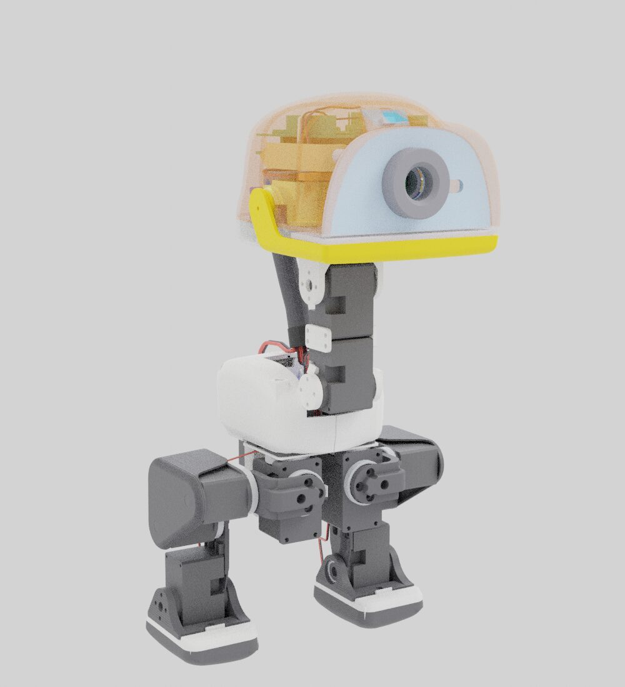
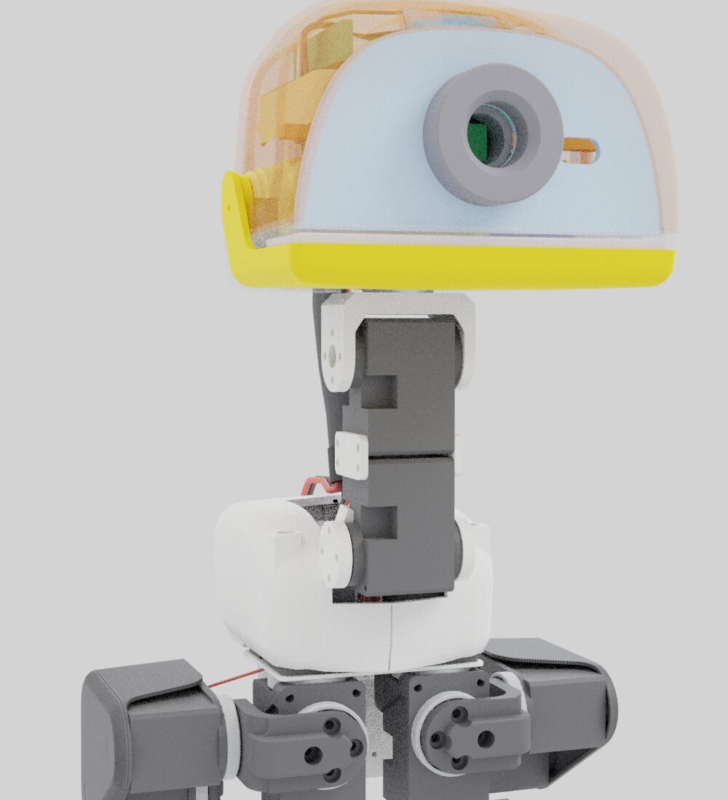
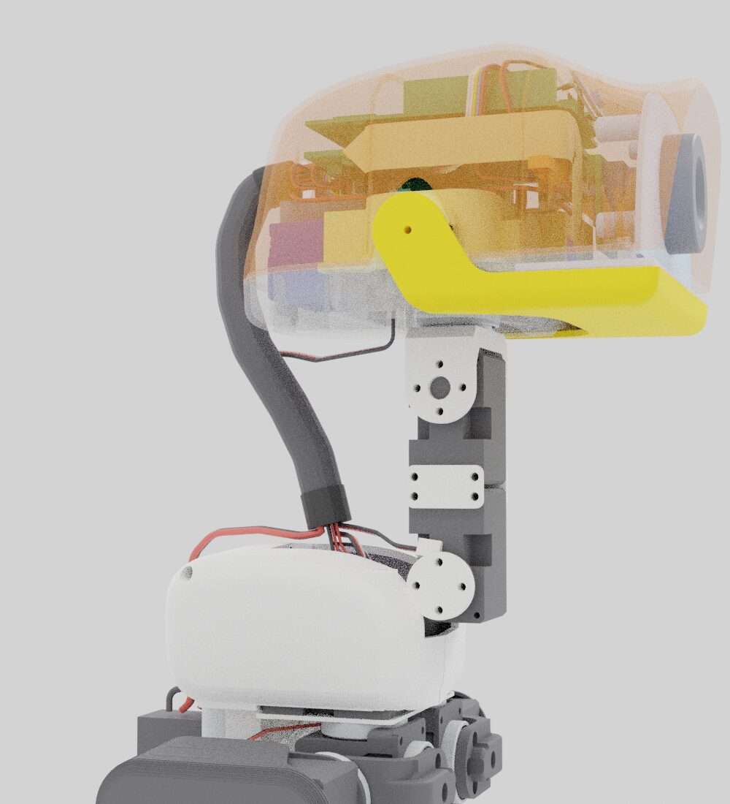
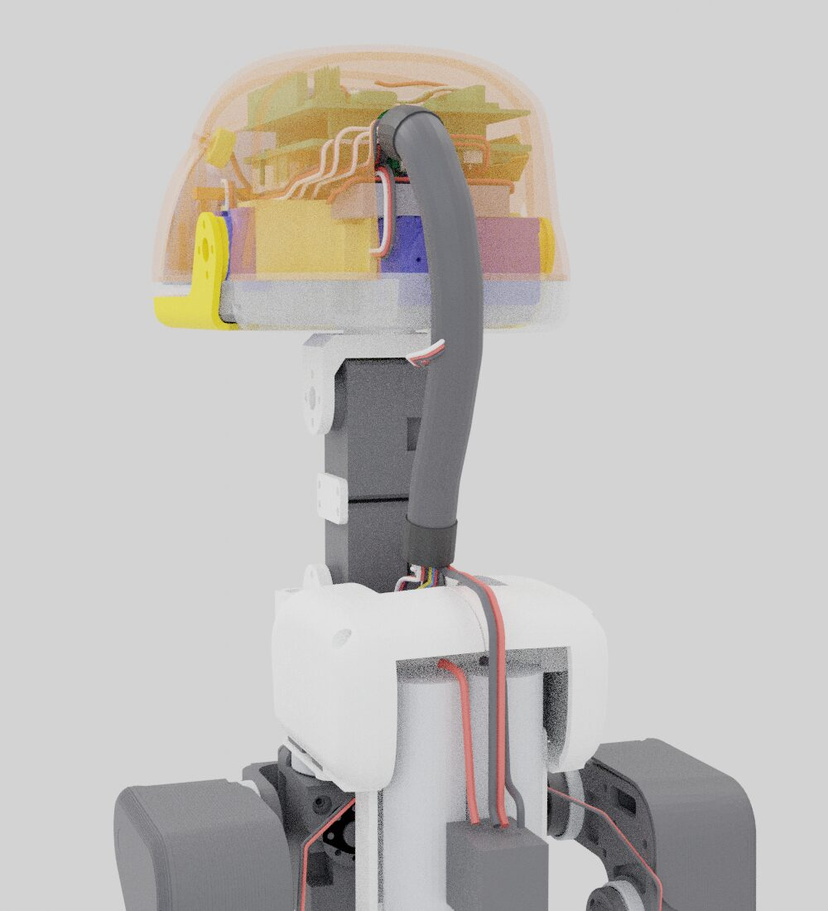

# Huebot printable parts

Every printed part of Huebot, the small walking robot we build, as STL files in millimetres, free to download and print yourself.

- **Our own geometry.** Every part is modelled in our own CAD system, from measurements of the parts we print and walk.
- **Reinforced where it broke.** The trunk base plate (motor-screw ears with 2.6 mm walls instead of 1.4 mm) and the battery holder (flange ears with 2.6 mm walls, 45° root gussets, a centre web) are the reinforced versions that replaced plates that broke in falls.
- **Legs for Feetech HD-1910 servos**, with 2 mm upper-leg rigidity plates.
- **Top head shell** that holds an Arduino UNO Q and its hat, with a two-piece front bracket.

## Licence

Hardware licence: **[CERN-OHL-W-2.0](https://ohwr.org/cern_ohl_w_v2.txt)** (CERN Open Hardware Licence v2, weakly reciprocal; full text in `LICENSE`). You may print, change, share and sell these parts. If you share changed versions of these files, share them under the same licence.

## Parts (one robot)

| File | Qty | Size mm (x × y × z) | Colour on ours |
|---|---:|---|---|
| `stl/body-trunk-shell-left.stl` | 1 | 33.7 × 80.9 × 41.8 | white |
| `stl/body-trunk-shell-right.stl` | 1 | 31.8 × 80.9 × 41.7 | white |
| `stl/body-trunk-base.stl` | 1 | 58.5 × 37.3 × 3.0 | white |
| `stl/body-power-support.stl` | 1 | 55.8 × 18.3 × 83.1 | white |
| `stl/body-pcb-locker.stl` | 1 | 54.0 × 3.8 × 6.6 | white |
| `stl/body-neck.stl` | 2 | 2.0 × 20.0 × 11.0 | white |
| `stl/body-neck-pitch.stl` | 1 | 35.0 × 18.0 × 27.7 | white |
| `stl/leg-hip-bracket.stl` | 2 | 32.4 × 34.5 × 19.0 | black |
| `stl/leg-yaw2roll.stl` | 2 | 23.0 × 25.8 × 20.5 | black |
| `stl/leg-bearing-roll.stl` | 2 | 23.0 × 3.5 × 40.0 | black |
| `stl/leg-upper-left.stl` | 1 | 28.0 × 47.6 × 60.9 | black |
| `stl/leg-upper-right.stl` | 1 | 28.0 × 47.6 × 60.9 | black |
| `stl/leg-upper-rigidity-plate.stl` | 2 | 2.0 × 45.2 × 58.5 | black |
| `stl/leg-shin.stl` | 2 | 7.6 × 20.0 × 58.0 | black |
| `stl/leg-ankle-left.stl` | 1 | 39.5 × 36.5 × 25.5 | black |
| `stl/leg-ankle-right.stl` | 1 | 39.5 × 36.5 × 25.5 | black |
| `stl/leg-foot-left.stl` | 1 | 40.1 × 54.0 × 16.9 | white |
| `stl/leg-foot-right.stl` | 1 | 40.1 × 54.0 × 16.9 | white |
| `stl/leg-sole-left.stl` | 1 | 41.1 × 54.0 × 12.9 | black |
| `stl/leg-sole-right.stl` | 1 | 41.1 × 54.0 × 12.9 | black |
| `stl/head-bottom-shell.stl` | 1 | 91.7 × 116.7 × 20.1 | yellow |
| `stl/head-top-shell-unoq.stl` | 1 | 91.8 × 122.7 × 58.8 | any |
| `stl/head-unoq-front-bracket.stl` (2 pieces in one file) | 1 | 79.3 × 5.0 × 9.1 | any |
| `stl/head-face.stl` | 1 | 87.6 × 12.5 × 44.6 | light blue |
| `stl/head-jaw.stl` | 1 | 91.2 × 68.7 × 29.5 | yellow |
| `stl/head-jaw-soft.stl` | 1 | 87.6 × 32.1 × 8.3 | black |
| `stl/head-soft-mouth-top.stl` | 1 | 87.7 × 32.6 × 3.1 | black |
| `stl/head-eye-ring.stl` | 1 | 30.0 × 9.5 × 30.0 | grey |
| `stl/head-m12-lens-holder.stl` | 1 | 24.0 × 14.8 × 16.0 | grey |
| `stl/head-motor-support.stl` | 1 | 73.5 × 54.2 × 18.8 | any |

37 printed pieces from 30 files. Parts are placed where they sit in the assembled robot, so lay each one flat in your slicer.

## Print settings

- **Material:** PLA for every part. TPU 95A also works for `head-jaw-soft` and `head-soft-mouth-top` if you want a soft beak.
- **Brim: always**, 5 mm, on every PLA part.
- 0.4 mm nozzle, 0.2 mm layers, 3 walls, 15 to 20 % infill.
- Supports: tree supports, on the build plate only, where the slicer asks for them.
- Print `head-bottom-shell` the way it is modelled (flat side down). Do not auto-orient it.
- A few files (trunk shell left, motor support, feet) have small open edges. Bambu Studio, OrcaSlicer and PrusaSlicer repair them on import.
- The trunk base takes load when the robot falls. PETG is stronger there if you have it.

## Screws (one robot)

Cross pan head (PH0), machine thread, black.

| Size | Qty |
|---|---:|
| M2 × 5 | 111 |
| M2 × 8 | 22 |
| M2.5 × 6 | 5 (each thigh takes 2 into its servo) |
| M2 brass hex standoff, female-male, 6 mm body + 3 mm thread | 5 |
| M2 flat washer 2.2 × 5 × 1.0 mm | 5 |

Tools: PH0 screwdriver (M2) and PH1 (M2.5).

## Other parts you need

- 15 × Feetech HD-1910 servos (13 in the body and legs, 2 in the head: head roll and mouth)
- Arduino UNO Q and its hat, 2S 18650 battery pack with a switch, trunk IMU board
- Bearings: 11 × MR1622-ZZ (22 × 16 × 4 mm), 2 × MR6700 (15 × 10 × 3 mm)

## Print it on our farm

No printer? Upload these STL files at **https://ce-net.com/print/order/** and our print farm prints them for the cost of printing: one build plate is $39, and shipping is shown at checkout. You get a photo of the plate before it ships.

## Renders

| Front | Side | Back |
|---|---|---|
|  |  |  |

Page: https://ce-net.com/huebot/parts/
